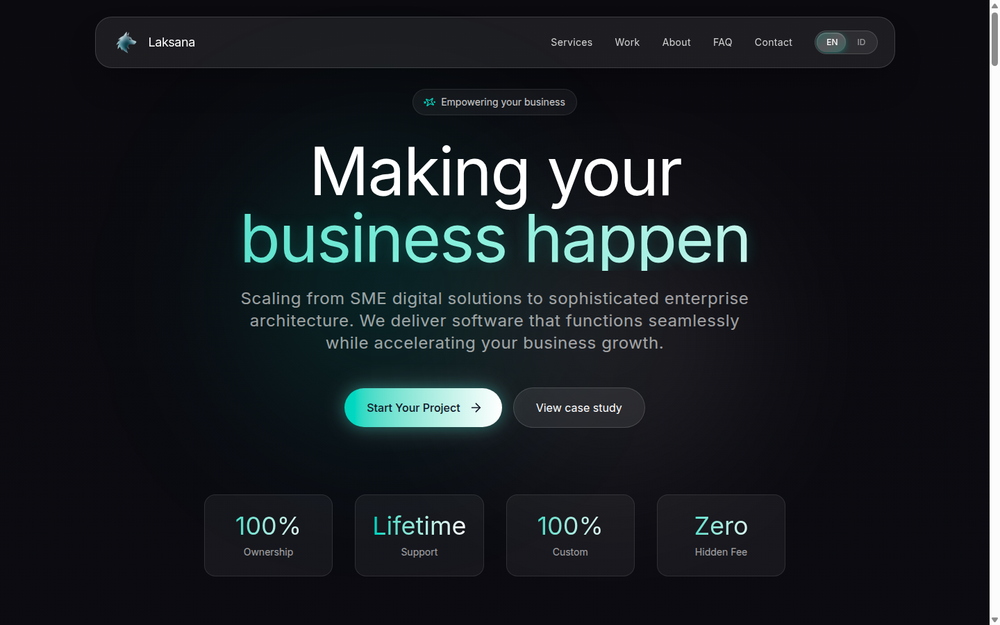

# Laksana

Website for Laksana, a studio that builds mobile apps, web applications and landing pages for small businesses up to
enterprise teams. English and Indonesian, with every string translated and checked in CI.

Live at [laksana-landing.vercel.app](https://laksana-landing.vercel.app).



## What is on it

- **Home**: hero, services, selected work, how we work, tech stack, testimonials, FAQ and a call to action
- **Services**, **Work** (case studies), **Testimonials**, **FAQ**, **About**, **Careers** and a **Blog** with detail pages
- Language in the URL (`/en/...`, `/id/...`) with a switcher that keeps you on the same page

## Internationalisation

Strings live in typed locale files (`src/i18n/locales/en.ts`, `id.ts`) and are read through react-i18next, so a missing
key is a type error. Scripts in `scripts/` extract strings from the source, report coverage and missing keys, and
regenerate the coverage badges. A Playwright smoke test opens each page in both languages.

## Stack

React 18 and TypeScript on Vite (SWC), React Router, Tailwind CSS with Radix primitives, Framer Motion, Embla
carousels, Recharts and Lucide icons. Tests run on Playwright.

## Run it locally

```sh
npm install
npm run dev          # http://localhost:5173
npm run build        # static site in dist/
```

| Script | Does |
| --- | --- |
| `npm run typecheck` | TypeScript, no emit |
| `npm run i18n:validate` | Translation coverage and missing keys, then typecheck |
| `npm run i18n:update` | Extract strings, validate, regenerate badges |
| `npm test` | Playwright end-to-end tests |
| `npm run test:e2e:smoke` | Both languages on every page |
